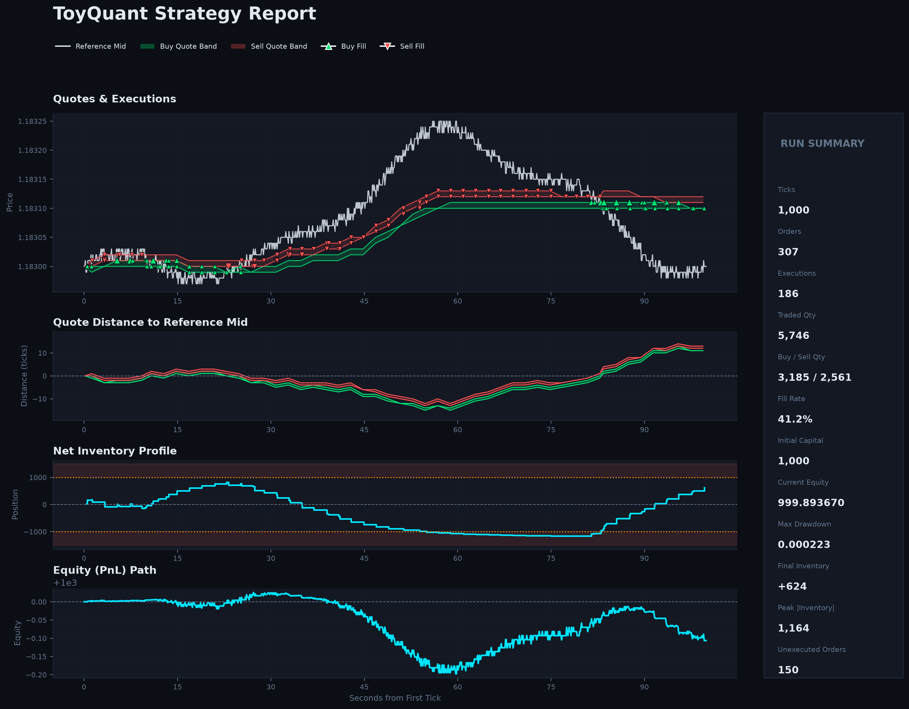

<div align="center">

# ToyQuant

**A reproducible C++20 market-making simulator — from ticks to trades to PnL.**

[](CMakeLists.txt)
[](CMakePresets.json)
[](tests)
[](LICENSE)

[User Guide](docs/USER_GUIDE.md) · [Design Review](docs/DESIGN_REVIEW.md) · [Architecture](docs/ARCHITECTURE.md) · [Performance](docs/PERFORMANCE.md) · [Low-Latency Design](docs/LATENCY_DESIGN.md) · [Learning Path](docs/LEARNING.md) · [Data Formats](data/README.md)

</div>

---

ToyQuant replays market data through the complete trading loop — market events, order book, strategy, matching, execution reports, and portfolio metrics — so you can observe every decision a market maker makes.

It is a toy project for learning and experimentation, not a production trading system. APIs, scenarios, and strategy behavior may change between versions.

## What this repository is, in two halves

**A low-latency C++20 replay engine.** A market data reader, an L2 ladder, a matching engine with price–time priority and a
queue model, an order state machine, a fee model that charges a broker's schedule the way a broker charges it, and a
portfolio ledger — re-derived by four gate tiers on every commit. The measured work behind it is in
[Low-Latency Design](docs/LATENCY_DESIGN.md) and [Performance](docs/PERFORMANCE.md): a line reader that was 61 percent of
an event and was halved, a ladder sized for one instrument, per-symbol state keyed by an integer id, a single-producer
ring between the feed and the strategy, a stage profiler, and an integer-plus-scale price parse that is bit-identical to
the decimal one.

**A measurement project that used it to close eight markets with numbers.** The question was whether a personal
account's quote can pay for itself, and the answer is no in every market tested, each closed by a quotient rather than
by an opinion:

| market | the number that closed it |
|---|---|
| crypto perpetuals, the micro E-mini, SPY | the fee is a multiple of the spread the venue offers |
| US large cap equities | the quoting margin was positive in 16 of 16 windows against a position term of 10,588 USD, and the fee floor binds on 79 percent of order instances |
| options one day out | the spread is payment for tail risk, and the premium can be smaller than the fee floor |
| options fifteen days out | the fee axis passed for the first time; the print count did not, at R_max 56 against a reference of 71 |
| funding rate carry, two venues, twelve months | 0 of 12 months clear the level and payback gates, and no run pays the 36 USD round trip |
| a low turnover reversion rule | 4 of 8 windows positive, and the payoff is small wins against large losses |

What that is worth to an engineer is the part an interview cannot fake: **the reason each of those doors is closed,
measured rather than assumed** — the fee against the tick, the position's own move against the edge, the number of
actions a window contains, and a 20 ms cancel latency that turned 0.095 ticks of capture into -0.44.
[Retrospective](docs/RETROSPECTIVE.md) is the closing document and [Roadmap](docs/ROADMAP.md) is the reasoning behind
it; the total spent on data across all eight lines was 1.27 USD.

## Verification, because the claims are the product

Every number in these documents is re-derived from the binary, and the gate is what enforces it:

* `tools/verify_l2.sh fast` is the per-edit tier: the unit tests, an L2 slice with batch, order, fill, PnL and queue
  invariants, the L1 checks, and the record-and-replay round trips;
* `tools/verify_l2.sh all` adds the full-file stdout hash against a cached reference, and the same tests under
  AddressSanitizer and UndefinedBehaviorSanitizer;
* `tools/lint_prose.py` refuses a flag or a queue model named in a document that the binary does not accept, and
  `tools/check_docs.py` re-derives every quoted run block;
* the strategy rules and the pass criteria were written down **before** the data that decided them was bought, and every
  download is priced with a free query first — `tools/screen_spread.py` and `tools/venue_ratio.py` refuse to spend
  without a cap.

## Versions

The line that predates the queue model — the Binance Trade+BBO replay, the legacy CSV and UDP inputs, and the
L1 strategy set — is frozen at the tag `v1.0-demo` and stays downloadable for reproducing the earlier
results. This branch is the current line: the [Changelog](CHANGELOG.md) says what changed and why, and
[docs/ROADMAP.md](docs/ROADMAP.md) says what comes next.

## Demo

```console
$ ./out/build/linux-debug/toy_quant csv data/scenarios/sample_ticks.csv 0 optimized

[Mode: Legacy CSV] Opening: .../data/scenarios/sample_ticks.csv (delay: 0ms) strategy=optimized
...
[EXECUTION] submitted_orders=24 submitted_quantity=1302 cancel_requests=9 trade_reports=11
            fill_rate=0.318 cancel_rate=0.375 trade_report_quantity=414 working_orders=6
```

The same input and parameters produce deterministic runtime CSV output for this simulator.

## How It Works

```text
 Legacy CSV ──╮
 Legacy UDP ──┼─► Tick adapter ─► Pipeline ─► Strategy ─► Matching Engine
 Binance replay ─► MarketEvent ──╯                              │
 Deribit L2 replay ─► L2OrderBook ─► L2MarketView ──────────────╯
                                                               ▼
                                             orders.csv / trades.csv
                                                               │
                                             backtest_main ─► PnL · equity · drawdown
```

- **Four current modes** — legacy CSV scenarios, legacy UDP ticks, Binance Trade+BBO replay, and Deribit L2 trade+depth replay. The Deribit L2 path is the mainline: it is the only one that models the queue a quote waits behind, so every result in these documents comes from it. The other three are kept for compatibility and for pinned regression invariants.
- **L2 strategy line** — `passive_l2` is the conservative baseline, `inventory_aware_l2` emphasizes position control, `flow_aware_l2` isolates flow behavior, and `active_l2` is the comprehensive mainline combining depth, micro-price, trade flow, inventory limits, toxicity protection, weak-flow protection, and volatility adaptation. `adaptive_l2` remains a compatibility alias for `active_l2`.
- **One v2 event path** — Binance replay uses `MarketEvent`; CSV and UDP remain compatibility inputs for the older `Tick` model.
- **Price–time priority matching** with self-trade prevention and partial fills.
- **Stateful execution reports** — position and working orders update from trade, cancel, and fill events.
- **Deterministic backtests** — realized/unrealized PnL and a reusable drawdown calculation.
- **Small toolchain** — CMake, a C++20 compiler, and Python 3 for the optional scenario and report tools.

## Evaluation and Validation Protocol

ToyQuant now uses a fixed benchmark regime for strategy comparison. The benchmark is designed to avoid false signals from overly short windows and from churn-based strategies that submit many orders without generating durable execution quality.

Primary metrics:

- `net_pnl` for outcome comparison
- `fill_rate` and `cancel_rate` for execution quality
- `queue_ahead_consumed` for L2 top-level queue-position diagnostics
- `fees_paid` and `fee_ratio` for fee-adjusted results
- `realized`, `unrealized`, `equity`, and `gross_pnl` for completeness
- `avg_markout_20`, `avg_quote_age_us`, `against_depth`, and `against_flow` for regime diagnostics

Recommended workflow:

```bash
cmake --build build --target l2_strategy_test
ctest --test-dir build --output-on-failure -R l2_strategy_test
python3 tools/benchmark_l2_strategies.py \
  --binary build/toy_quant \
  --trades data/v2/deribit_trades_2020-04-01_BTC-PERPETUAL.csv.gz \
  --depth data/v2/deribit_book_snapshot_25_2020-04-01_BTC-PERPETUAL.csv \
  --symbol BTC-PERPETUAL \
  --start-ts 1585699200000000 \
  --end-ts 1585699500000000 \
  --depth-every 1
```

Do not treat a one-window win as final. Tune only if the candidate remains competitive across at least two moderate windows and keeps the cancel rate and markout profile reasonable.

## Quick Start

Requirements: CMake 3.16+, a C++20-capable compiler, and Python 3.

```bash
cmake --preset linux-debug
cmake --build --preset linux-debug
ctest --preset linux-debug
```

**Run a legacy CSV scenario** (flat, trending, shock, and random markets ship in [data/scenarios](data/scenarios)):

```bash
./out/build/linux-debug/toy_quant csv data/scenarios/flat_ticks.csv 0 optimized
```

**Stream legacy ticks over UDP** (and send a scenario from another terminal):

```bash
./out/build/linux-debug/toy_quant udp 9000 naive
python3 tools/udp_sender.py --port 9000
```

**Replay Binance Trade+BBO data**:

```bash
./out/build/linux-debug/toy_quant replay \
  data/v2/test_aggTrades_5k.csv \
  data/v2/test_bookTicker_5k.csv \
  BTCUSDT 0 optimized 1000000
```

**Replay Deribit L2 trades and snapshots** (slice the large snapshot first):

```bash
python3 tools/slice_l2_snapshot.py \
  data/v2/deribit_book_snapshot_25_2020-04-01_BTC-PERPETUAL.csv \
  /tmp/deribit_depth.csv --start-ts 1585699200000000 --every 5 --max-rows 300
./out/build/linux-debug/toy_quant l2_replay \
  data/v2/deribit_trades_2020-04-01_BTC-PERPETUAL.csv.gz \
  /tmp/deribit_depth.csv BTC-PERPETUAL 0 flow_aware_l2 1
```

**Record a session and replay it again**: `--record=PREFIX` writes the stream the run was fed back out in
the replay shapes, `PREFIX_trades.csv` and `PREFIX_depth.csv`, so the same binary can be given those files
instead. `bash tools/verify_l2.sh fast` asserts that the replayed recording reports the same numbers.

```bash
./out/build/linux-debug/toy_quant l2_replay \
  data/v2/deribit_trades_2020-04-01_BTC-PERPETUAL.csv.gz \
  /tmp/deribit_depth.csv BTC-PERPETUAL 0 flow_aware_l2 1 --record=/tmp/session
./out/build/linux-debug/toy_quant l2_replay \
  /tmp/session_trades.csv /tmp/session_depth.csv BTC-PERPETUAL 0 flow_aware_l2 1
```

**Hand the stream to a second thread**: `--feed-thread` reads on its own thread and passes each event to
the strategy thread over a bounded ring, so the reader's work runs beside the strategy's instead of in
front of it. The run reports what that cost as a `[LATENCY]` line, with a p50 and a p99 for the ring
wait, the processing and the total.

```bash
./out/build/linux-debug/toy_quant l2_replay \
  data/v2/deribit_trades_2020-04-01_BTC-PERPETUAL.csv.gz \
  data/v2/deribit_incremental_book_L2_2020-04-01_BTC-PERPETUAL.csv \
  BTC-PERPETUAL 0 active_l2 1 --fast-validation --feed-thread
```

**Put a broker between the strategy and the exchange**: `--paper-broker` refuses orders, fills in pieces,
loses an execution report and takes the venue away for a while, and keeps its own statement of what the
venue executed, which the run reports as `[BROKER]` and reconciles against the portfolio as `[RECON]`. With
no fault configured it forwards every call and every report, so the run is the run without it and tier 1 of
the gate asserts that; a fault is a count of orders or fills rather than a draw, so a faulted run is
reproducible from its command line, and a fault the run cannot show is refused.

```bash
./out/build/linux-debug/toy_quant l2_replay \
  data/v2/deribit_trades_2020-04-01_BTC-PERPETUAL.csv.gz \
  data/v2/deribit_incremental_book_L2_2020-04-01_BTC-PERPETUAL.csv \
  BTC-PERPETUAL 0 active_l2 1 --fast-validation --paper-broker \
  --broker-outage-after=50 --broker-outage-holds=100
```

**Analyze legacy generated order and trade records**:

```bash
./out/build/linux-debug/backtest_main \
  data/scenarios/sample_ticks.csv \
  data/runtime/orders.csv \
  data/runtime/trades.csv \
  0 0 backtest logs/backtest.log
```

Generate your own scenarios with a fixed seed for reproducible runs:

```bash
python3 tools/gen_ticks.py all --count 1000 --seed 42 --output-dir data/scenarios
```

## Output

Each `toy_quant` run creates or truncates:

- `data/runtime/orders.csv` — every order the strategy submitted.
- `data/runtime/trades.csv` — every execution report the engine returned.

Legacy CSV/UDP runs include a `# source_ticks=...` metadata line. Replay runs include
`# source_market_data=...` with the trade and BBO sources. `backtest_main` reads the legacy
`source_ticks` format; older runtime files without metadata remain readable.

The default backtest log is `logs/backtest.log`.

## Visual Report

Generate a static report with the market price, strategy quotes, executions, net inventory, and run summary:

```bash
python3 -m venv .venv
.venv/bin/python -m pip install -r requirements.txt
.venv/bin/python tools/plot_report.py \
  --ticks data/scenarios/synthetic_ticks.csv \
  --orders data/runtime/orders.csv \
  --trades data/runtime/trades.csv \
  --output reports/synthetic_ticks_optimized.png
```

The generated PNG is designed for quick inspection and README screenshots. Runtime CSV files are overwritten by the next simulation, so generate or copy the report before starting another run.



## Non-Goals

ToyQuant deliberately excludes real exchange connectivity, FIX, a risk gateway, persistence and recovery, nanosecond-latency claims, and full L2 market reconstruction. Keeping these out of scope is what keeps the core loop small enough to read in one sitting.

## Documentation

| Document | Contents |
|---|---|
| [Design Review](docs/DESIGN_REVIEW.md) | Why the demo is built this way: the constraints it holds itself to, the decisions and rejected alternatives behind each component, the measured headline results, what is still wrong with it, and the 30-second version of the pitch |
| [Retrospective](docs/RETROSPECTIVE.md) | The closing document: the eight markets this project closed and the number that closed each one, the three things that survive them, and what the search phase left behind |
| [User Guide](docs/USER_GUIDE.md) | CLI reference, scenarios, experiments, data contracts, and troubleshooting |
| [Learning Path](docs/LEARNING.md) | The market-making mechanisms the simulator exists to show, and a field reference |
| [Architecture](docs/ARCHITECTURE.md) | Data flow, module responsibilities, matching rules, order lifecycle |
| [Performance](docs/PERFORMANCE.md) | Workloads, how to measure on this host, the current stage breakdown, and the ledger of every optimization attempted |
| [Low-Latency Design](docs/LATENCY_DESIGN.md) | Why each low-latency change is faster, how it was verified, and what was measured and rejected |
| [Performance History](docs/PERFORMANCE_HISTORY.md) | Superseded measurements in the order they were taken |
| [Documentation Index](docs/index.md) | Which document to read for which question, and what keeps each of them honest |
| [Roadmap](docs/ROADMAP.md) | The phases from this demo to a personal execution system, and what is deliberately not planned |
| [Data Files](data/README.md) | Tick CSV format, runtime outputs, typical workflow |

## Contributing

Bug reports, documentation improvements, and focused tests are welcome. Please open an issue before proposing new features.

## Disclaimer

This project is for educational purposes only. It does not provide investment advice and must not be used for live trading.

---

<div align="center">
Created and maintained by <a href="https://github.com/12mango">12mango</a> · <a href="mailto:1498159938@qq.com">Contact</a> · <a href="LICENSE">MIT License</a>
</div>
